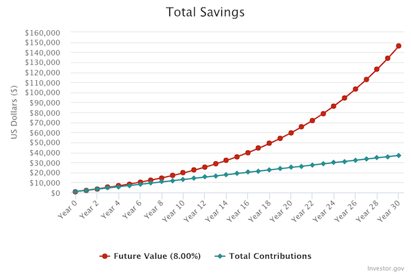

_Disclaimer: I am not a financial advisor. This article reflects my personal research and investment strategy. Always do your own research before investing._

---
 

I turned eighteen last December, and I have been actively investing and trading ever since. As I am still in the process of figuring out what works best for me by experimenting with different strategies, this article serves as a snapshot of my current financial philosophy, my actions, and why I believe in this approach.

## My Investing Philosophy

### Compound Interest
At a young age, the greatest leverage you have is time. Let's say you start investing when you turn 20. If you calculate based on an average annual return of 8%, then over 30 years — by the time you turn 50 — your initial investment will have grown **tenfold**. 

If you continue adding capital to that initial investment on a regular basis, compound interest works even harder:

The chart assumes an initial investment of $1,000 with $100 added monthly at an average annual return of 8%. With a total contribution of $37,000, the invested money nearly quadruples to almost $146,000 over 30 years. Feel free to try using [this calculator](https://www.investor.gov/financial-tools-calculators/calculators/compound-interest-calculator).

The point is that compound interest offers huge potential, so my investing strategy is primarily built around that.

## My Current Portfolio

### Stocks ~ 10%
Stock trading, picking individual stocks, and investing in them can be really attractive, since we have all seen stocks go to the moon and beyond, but one should never forget the immense risk stock trading carries. Still, it can be fun trying to speculate, read news, and analyze companies.

I do invest in stocks, but only with a small portion of my portfolio. My problem with stock trading is that picking single stocks and reviewing investments consumes a lot of time, and, backed by extensive research, a single broad-market ETF routinely outperforms individual stock picking over long time horizons.

### ETF ~ 60%
> ETF stands for exchange-traded fund, which is a single investment fund that holds a collection of many assets — such as stocks, bonds, or commodities — and trades on public stock exchanges just like a regular company stock. When you buy one share of an ETF, you instantly own a tiny piece of every underlying investment inside the fund.

ETFs come in all shapes and sizes. There are many different approaches, and there is no one-size-fits-all solution. When choosing one, you have to consider things like your investment time horizon, the risk you are willing to take, and essentially, what you believe in.

I didn't want to make things too complicated for myself, as I believe that simplicity and consistency beat highly optimized solutions that you might not be able to follow or might stop believing in after a couple of months. I chose a single ETF to put my money into: the [Amundi Prime All Country World UCITS ETF Acc](https://www.justetf.com/en/etf-profile.html?isin=IE0003XJA0J9), which is known under the ticker WEBN.

The name Amundi Prime All Country World UCITS ETF Acc might sound a bit confusing, so let me break it down:

* **Amundi Prime** – Basically the "brand name" of the ETF line. Amundi is a French asset management company.
* **All Country World** – I wanted to buy something that covers global markets. I believe in diversification and didn't want to invest solely in the US market.
* **UCITS ETF** – A European-regulated ETF structure. This specific fund is domiciled in Ireland, which makes it more tax-efficient for holding global/US stocks.
* **Acc** – Short for "Accumulating." The dividends paid by the underlying stocks are automatically reinvested into shares of the ETF.

I preferred it over the [Vanguard FTSE All-World UCITS ETF (USD) Acc](https://www.justetf.com/en/etf-profile.html?isin=IE00BK5BQT80) (ticker: VWCE) because it basically has the same performance, but offers a lower fee and is managed by a European company.

> **A Note for Hungarian Residents** 
> Since I live and pay taxes in Switzerland, I don't personally use a TBSZ (*Tartós Befektetési Számla*). However, if you are a tax resident in Hungary, I strongly recommend opening one. It reduces your capital gains tax from 15% down to 0% after a 5-year holding period, saving you a lot of money in the long run.

### Hungarian Treasury ~ 30%
A really good piece of advice that I once received about trading is that you should never trade with money you need. ETF investing is profitable in the long term (3+ years), and stock trading carries heavy risk. That is why I keep a relatively high percentage of my portfolio in Hungarian Government Securities. Currently, they yield around 5.8% a year, are easy to liquidate, and carry almost zero risk. That way, if I ever find myself in a situation where I need more money, I can liquidate these first and don't have to sell positions that might currently be underwater.

> **Webkincstár** 
> For fellow Hungarians who have recently turned eighteen — or do not yet have an account — I recommend opening one at the Hungarian Treasury (_Magyar Államkincstár_) via [Webkincstár](https://webkincstar.allamkincstar.gov.hu). It currently offers a relatively high interest rate with virtually zero risk for shorter horizons (e.g., 4.61% APY on the 3-month Discount Treasury Bill), and you may also be eligible for state-provided [life-start support](https://magyarorszag.hu/szuf_ugyleiras?id=f5be6ed1-5f2f-4e29-8062-c3b09ab48a48).

---
 

Looking at the bigger picture, starting to invest for the first time is not easy — there have always been concerns. Today it is the AI bubble, five years ago it was war and rising tensions: the point is, there are always things to scare people off investing, but the best time to start is actually today. Over the long term, broad stock markets have delivered positive returns.

If you have any comments, ideas, or notes on the topic, feel free to reach out at gergo@miszori.dev!